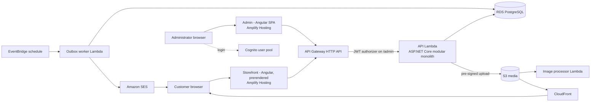
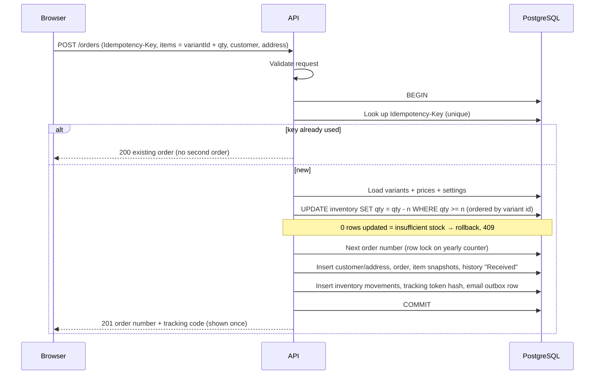

# ZLADOVCE – ARCHITECTURE

> Part of the Zladovce master specification. Related documents:
> [PROJECT_SPECIFICATION](PROJECT_SPECIFICATION.md) · [DATABASE](DATABASE.md) · [API_SPECIFICATION](API_SPECIFICATION.md) · [AWS_INFRASTRUCTURE](AWS_INFRASTRUCTURE.md) · [IMPLEMENTATION_PLAN](IMPLEMENTATION_PLAN.md)

---

# 2. TECHNOLOGY STACK

## Frontend
- Angular, latest stable version compatible with the project.
- TypeScript.
- Angular Router.
- Angular Reactive Forms.
- Tailwind CSS and/or Angular Material.
- Responsive mobile-first design.
- Reusable standalone components.
- Lazy-loaded routes.
- Strong TypeScript typing.
- Proper loading, error and empty states.

Use a well-structured Angular workspace containing:
- Public storefront application.
- Admin application.
- Shared libraries.

## Backend
- .NET 10 LTS.
- ASP.NET Core Web API.
- Entity Framework Core.
- PostgreSQL.
- REST API.
- FluentValidation.
- Swagger / OpenAPI.
- Structured logging.
- Dependency Injection.
- Modular monolith architecture.

## AWS

See [AWS_INFRASTRUCTURE.md](AWS_INFRASTRUCTURE.md) for the AWS services and deployment requirements.

Do not introduce microservices.

---

# 3. ARCHITECTURE

Use a modular monolith with clear boundaries.

Backend projects:

- Zladovce.Domain
- Zladovce.Application
- Zladovce.Infrastructure
- Zladovce.Api
- Zladovce.Lambda

Tests:

- Zladovce.UnitTests
- Zladovce.IntegrationTests

Logical backend modules:

1. Identity
2. Catalog
3. Categories
4. Inventory
5. Cart
6. Orders
7. Shipping
8. Tracking
9. Notifications
10. Analytics
11. CMS
12. Blog
13. StoreSettings
14. Audit

Follow SOLID principles and use Clean Architecture concepts where they provide practical value.

Use:
- DTOs
- Domain entities
- Application services
- Repository abstractions where justified
- Dependency injection
- Centralized exception handling
- Consistent API response formats
- Request validation
- Database migrations

Do not overengineer or introduce unnecessary abstractions.

Frontend workspace:

frontend/
- apps/storefront
- apps/admin
- libs/shared
- libs/api
- libs/auth
- libs/ui
- libs/models
- libs/utilities

Keep public storefront and administration visually and functionally separate.

Implement SSR or prerendering for public SEO-critical pages where supported by the selected hosting architecture.

Admin pages do not require SSR.

---

# 15. AUTHENTICATION AND SECURITY

Administrator authentication is required.

Customer accounts are not required.

Use Amazon Cognito for administrator authentication.

Implement:
- Secure authentication.
- Role-based authorization.
- Token validation.
- Protected admin routes.
- Backend authorization.
- Rate limiting.
- Input validation.
- Secure CORS.
- SQL injection protection.
- XSS protection.
- CSRF protection where applicable.
- Secure file uploads.
- Audit logging.
- Secrets management.

Never trust frontend authorization alone.

Never expose:
- AWS credentials.
- Database credentials.
- Internal API secrets.
- Tracking token hashes.
- Unnecessary customer information.

Use least-privilege IAM policies.

Use secure password and session handling through the chosen authentication provider.

---
---

# PHASE 1 – SYSTEM ARCHITECTURE (DESIGN)

Everything below this line is Phase 1 output (design), not part of the original master specification.

## A1. System overview



One deployable backend (the modular monolith) runs as the API Lambda. Two small helper functions exist only because their trigger is not an HTTP request: the outbox worker (scheduled) and the image processor (S3 event). They share the same code base and are not separate services.

## A2. Key decisions

| # | Decision | Reason |
|---|---|---|
| 1 | Modular monolith, one database, one schema per concern through naming, no microservices | Small team, small load, one transaction boundary for checkout |
| 2 | ASP.NET Core hosted in Lambda through `Amazon.Lambda.AspNetCoreServer.Hosting`; same app runs on Kestrel locally | No Lambda-specific code in controllers; easy local development |
| 3 | API Gateway **HTTP API** (not REST API) | Cheaper, built-in JWT authorizer for Cognito |
| 4 | Application services per module, EF Core `DbContext` used directly; repositories only for aggregates with real invariants (Order, Inventory) | Avoids a pass-through repository layer |
| 5 | No MediatR / CQRS framework | Not needed at this size |
| 6 | Guest cart lives in the browser (`localStorage`, variant id + quantity only); backend prices it through a quote endpoint | No server cart state to clean up; prices never come from the client |
| 7 | Transactional outbox in PostgreSQL for all emails | An email failure can never lose or roll back an order |
| 8 | Storefront is prerendered (static HTML per product, category, blog post) and rebuilt by webhook when content changes; price and stock are refreshed in the browser | SEO without paying for or operating an SSR runtime. Full SSR on Amplify is evaluated in a Phase 2 spike |
| 9 | IaC with **AWS CDK (TypeScript)** | Same language as the frontend, first-class AWS support |
| 10 | No RDS Proxy at launch; Lambda concurrency capped and connection pool kept small | Proxy would roughly double database cost for a load that does not need it (see AWS_INFRASTRUCTURE.md) |
| 11 | UUID v7 primary keys, `numeric(12,2)` money, `timestamptz` in UTC | Sortable ids, exact money, unambiguous time |
| 12 | Angular CLI multi-project workspace with `apps/` and `libs/`, path aliases `@zladovce/*`, lint rules for import boundaries | Structure requested by the spec without adding Nx |

## A3. Backend solution

```
backend/
├── Zladovce.sln
├── src/
│   ├── Zladovce.Domain/           Entities, value objects, enums, domain rules (no dependencies)
│   ├── Zladovce.Application/      Use cases, DTOs, validators, interfaces (ports)
│   ├── Zladovce.Infrastructure/   EF Core, migrations, S3, SES, Cognito, clock, token hashing
│   ├── Zladovce.Api/              Controllers/endpoints, auth, middleware, Swagger, Lambda HTTP entry
│   └── Zladovce.Lambda/           Non-HTTP handlers: OutboxWorker, ImageProcessor, MigrationRunner
└── tests/
    ├── Zladovce.UnitTests/
    └── Zladovce.IntegrationTests/  Real PostgreSQL through Testcontainers
```

Dependency rule: `Domain` ← `Application` ← `Infrastructure` ← `Api` / `Lambda`. `Application` never references `Infrastructure`.

Each layer is organised by module folder, not by technical type:

```
Zladovce.Application/
├── Catalog/        (ProductService, queries, DTOs, validators)
├── Categories/
├── Inventory/
├── Cart/           (CartQuoteService)
├── Orders/         (CheckoutService, OrderStatusService, OrderNumberGenerator)
├── Shipping/
├── Tracking/
├── Notifications/  (outbox writer, email composer, templates)
├── Analytics/
├── Cms/
├── Blog/
├── StoreSettings/
├── Identity/
├── Audit/
└── Common/         (paging, errors, clock, current user)
```

### Module responsibilities and boundaries

| Module | Owns | May call |
|---|---|---|
| Identity | Admin users (mirror of Cognito), roles, current-user resolution | Audit |
| Catalog | Products, variants, images | Categories, Inventory (read) |
| Categories | Categories | — |
| Inventory | Stock levels, movements, low-stock list | — |
| Cart | Pricing and validation of a client cart (stateless) | Catalog, Inventory, Shipping |
| Orders | Orders, items, status machine, order numbers, customers, addresses | Cart, Inventory, Shipping, Tracking, Notifications |
| Shipping | Shipping rules, couriers, shipments | StoreSettings |
| Tracking | Token generation, hashing, public lookup | Orders (read) |
| Notifications | Email outbox, templates, logs | — |
| Analytics | Dashboard and report queries (read only), expenses | reads Orders, Inventory, Catalog |
| CMS | Content pages, FAQ | — |
| Blog | Blog categories and posts | — |
| StoreSettings | Single settings record | — |
| Audit | Audit log writer and reader | — |

Modules call each other only through application-level interfaces. They share one `DbContext` so that checkout, stock and outbox are one transaction.

### Cross-cutting

- **Validation:** FluentValidation on every request DTO, run by an endpoint filter. Business rules are re-checked in services.
- **Errors:** one exception-handling middleware; responses use RFC 9457 Problem Details with a stable `code` and Serbian `detail` (see API_SPECIFICATION.md).
- **Logging:** Serilog, JSON to stdout → CloudWatch. Correlation id per request. Customer personal data and tracking codes are never logged.
- **Time:** `TimeProvider` everywhere; UTC in storage; `Europe/Belgrade` for order-number year, report periods and display.
- **Audit:** an EF Core `SaveChanges` interceptor records admin changes to audited entities; explicit audit entries for login, status changes, stock adjustments, settings changes.

## A4. Critical flows

### Checkout (order creation)



- Prices, discounts, shipping cost and totals are computed on the server from the database. The client sends ids and quantities only.
- The conditional `UPDATE … WHERE quantity_on_hand >= n` plus a `CHECK (quantity_on_hand >= 0)` constraint makes overselling impossible even with concurrent requests. Rows are updated in variant-id order to avoid deadlocks.
- The browser generates the idempotency key when checkout opens and disables the submit button while the request is in flight. A repeated request returns the first result.

### Order numbers

`ZLD-YYYY-000001`. A table holds one counter row per year. The counter row is locked and incremented inside the order transaction, so numbers have no gaps from failed orders and a unique constraint on `order_number` is the final guard. The year is taken in Serbian local time.

### Tracking tokens

- 130 bits from the system CSPRNG, encoded as 26 Crockford Base32 characters, shown grouped (`XXXXX-XXXXX-…`) so it can be typed.
- Only the SHA-256 hash is stored. A slow password hash is unnecessary for a 130-bit random value and would make lookup by hash impossible.
- The plain code is returned once in the create-order response and placed in the confirmation email. For the email it travels in the outbox row **encrypted** (AES-GCM, key in Secrets Manager) and that field is erased as soon as the email is sent.
- An order can have several valid tokens. Each later status email carries a link with its own freshly issued token, and "resend confirmation" in admin issues a new one. No plain token is ever stored.
- Email links put the code in the URL fragment (`/track-order#kod=…`) so it never reaches server or CDN logs. The page sends it in a POST body.
- Lookup failures always return the same generic answer in the same shape. Per-IP rate limiting is kept in PostgreSQL (Lambda instances share no memory), with API Gateway route throttling as a coarse outer limit.
- The tracking response contains order number, status, dates, timeline, customer-facing messages and courier data. No name, address, phone, email or items.

### Email outbox

1. Any code that needs an email inserts an outbox row in the same transaction as the business change. A unique `dedup_key` (for example `order:{id}:history:{historyId}`) prevents a second row for the same event.
2. The outbox worker runs every minute, claims due rows with `FOR UPDATE SKIP LOCKED` and a lease, renders the Serbian HTML template, sends through SES and records each attempt in the email log.
3. Failures retry with back-off (1 min, 5 min, 30 min, 2 h, 12 h). After the last attempt the row is marked dead and shown in the admin with a "Pošalji ponovo" action.
4. Residual risk: a crash between a successful SES call and the database update can cause one repeated email. The lease and attempt log keep this window to a single send; it is documented rather than hidden.

### Image upload

1. Admin asks the API for a pre-signed S3 POST (limits: content type JPEG/PNG/WebP, max 10 MB, key under `uploads/`).
2. Browser uploads straight to S3.
3. S3 event starts the image processor: verifies the file really is an image, strips metadata, writes WebP renditions (400, 800, 1600 px) under `media/…`, deletes the upload.
4. Admin confirms the image against the product; the API checks the renditions exist before saving the record.
5. Storefront serves `media/…` through CloudFront with long cache lifetimes and `srcset`.

## A5. Angular workspace

```
frontend/
├── angular.json
├── package.json
├── tsconfig.base.json            path aliases @zladovce/*
├── apps/
│   ├── storefront/               public shop (prerendered, Tailwind)
│   │   └── src/app/
│   │       ├── core/             layout, header, footer, SEO service, error handling
│   │       ├── features/
│   │       │   ├── home/  shop/  product/  cart/  checkout/
│   │       │   ├── order-confirmation/  order-tracking/
│   │       │   ├── blog/  content/ (o-nama, kontakt, FAQ, legal)
│   │       └── app.routes.ts     lazy routes per feature
│   └── admin/                    admin SPA (Angular Material + Tailwind utilities)
│       └── src/app/
│           ├── core/             shell, side navigation, auth guard
│           ├── features/
│           │   ├── dashboard/  orders/  products/  categories/  inventory/
│           │   ├── blog/  cms/  customers/  reports/  settings/
│           │   ├── admin-users/  audit-log/
│           └── app.routes.ts
└── libs/
    ├── models/       TypeScript types for API contracts (generated from OpenAPI)
    ├── api/          typed API clients, HTTP interceptors (errors, correlation id)
    ├── auth/         Cognito sign-in, token handling, guards, role directive (admin only)
    ├── ui/           design tokens, buttons, inputs, cards, badges, dialogs, states (loading/empty/error)
    ├── shared/       cross-app pieces: status labels, cart store, form validators
    └── utilities/    RSD and date formatting (Serbian locale), slug helpers
```

Rules:

- Standalone components, signals for local state, Reactive Forms, lazy-loaded feature routes.
- `apps/storefront` never imports `libs/auth`; `apps/*` never import each other. Enforced by lint.
- `libs/models` is generated from the backend OpenAPI document so the two cannot drift.
- Locale `sr-Latn-RS`; prices shown as `1.200 RSD`; dates shown in Serbian local time.
- Every data view implements loading, empty and error states from `libs/ui`.
- Cart store keeps `{variantId, quantity}` in `localStorage`, versioned, synced across tabs, and re-priced through the quote endpoint on every cart and checkout view.
- Admin tokens are kept in memory with the Cognito library handling refresh; nothing sensitive is written to `localStorage`.

Rendering:

- Storefront uses Angular hybrid rendering: prerender for content, product, category and blog routes (route list fetched from the API at build time); client rendering for cart, checkout, confirmation and tracking.
- A debounced Amplify build webhook is called when the administrator changes products, categories, blog or CMS content. Until the rebuild finishes the browser still shows fresh price and stock, because those are fetched live.
- `sitemap.xml` and `robots.txt` are generated in the same build. Product pages carry JSON-LD `Product` data, Open Graph tags and canonical URLs.

## A6. Security model

### Identities and roles

| Actor | Authentication | Can do |
|---|---|---|
| Customer (guest) | None | Browse, quote cart, create order, look up tracking by code |
| Urednik (Staff) | Cognito, group `Staff` | Orders, products, categories, inventory, blog, CMS, customers, reports |
| Vlasnik (Owner) | Cognito, group `Owner` | Everything above plus store settings, expenses, admin users, audit log |

- Cognito user pool per environment, self-registration disabled, admins invited by an Owner, strong password policy, optional TOTP MFA (recommended for Owner).
- Admin app shows its own Serbian sign-in form and uses the Cognito SRP flow; no password ever touches the Zladovce API.

### Authorization path

1. API Gateway JWT authorizer validates signature, issuer, expiry and app client for every `/api/v1/admin/*` route. Unauthenticated requests never reach the Lambda.
2. The API maps the token to an `admin_users` row (must be active) and enforces role policies on each endpoint.
3. Angular route guards and hidden menu items are convenience only.

### Controls

| Risk | Control |
|---|---|
| Price or stock tampering | Client sends ids and quantities only; server recomputes everything |
| Duplicate orders | Idempotency key with unique constraint |
| Overselling | Conditional update + check constraint inside the transaction |
| Tracking enumeration | 130-bit codes, hashed storage, generic error, per-IP rate limit, minimal response |
| Brute force / abuse of public POSTs | Per-IP limits on checkout, tracking, contact, newsletter; API Gateway throttling; honeypot field on forms |
| SQL injection | EF Core parameterised queries only; no string-built SQL |
| XSS | Angular escaping; blog/CMS HTML sanitised on the server on save with an allow-list; Content-Security-Policy header |
| CSRF | Not applicable to the API: bearer tokens in headers, no auth cookies |
| CORS | Exact allow-list of storefront and admin origins per environment |
| Malicious uploads | Pre-signed POST with type and size conditions, server-side re-encoding, uploads never served directly |
| Secrets | Secrets Manager and IAM database authentication; nothing in source or frontend builds |
| Data exposure | DTOs per audience; public DTOs never include hashes, internal notes, cost or customer data |
| Admin misuse or mistakes | Audit log of who changed what, status history with administrator identity |
| Transport | HTTPS everywhere, HSTS, TLS to the database |
| Personal data | Only checkout data is collected; no tracking cookies in the MVP; retention and deletion procedure documented in Phase 8 |

### Future extension points

- **Customer accounts:** `customers` already exists; add an optional identity link and a second Cognito pool. Orders keep working for guests.
- **Card payments:** `payment_method` is already a field; add a `payments` table and a provider adapter behind an interface in the Orders module.
- **Courier APIs:** shipments reference a courier record; an `ICourierIntegration` adapter can be added per courier without changing orders.
