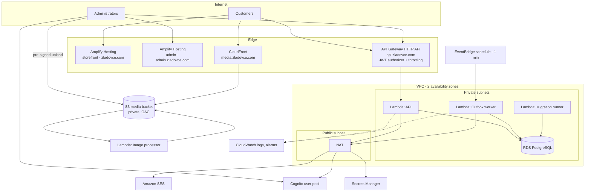

# ZLADOVCE – AWS INFRASTRUCTURE

> Part of the Zladovce master specification. Related documents:
> [PROJECT_SPECIFICATION](PROJECT_SPECIFICATION.md) · [ARCHITECTURE](ARCHITECTURE.md) · [DATABASE](DATABASE.md) · [API_SPECIFICATION](API_SPECIFICATION.md) · [IMPLEMENTATION_PLAN](IMPLEMENTATION_PLAN.md)

---

# AWS SERVICES (from §2 Technology Stack)

Use:
- AWS Amplify for Angular hosting.
- Amazon API Gateway.
- AWS Lambda for .NET API hosting.
- Amazon RDS PostgreSQL.
- RDS Proxy where appropriate.
- Amazon S3 for product images and media.
- Amazon CloudFront for image delivery.
- Amazon SES for transactional emails.
- Amazon Cognito for administrator authentication.
- AWS Secrets Manager.
- Amazon CloudWatch.
- IAM least-privilege policies.

Use Infrastructure as Code through AWS CDK or Terraform.

Keep infrastructure cost-efficient.

Do not introduce microservices.

---

# 18. AWS DEPLOYMENT AND OPERATIONS

Prepare separate environments:
- Development.
- Staging.
- Production.

Use environment-specific configuration.

Implement:
- Infrastructure as Code.
- CI/CD pipeline.
- Database migrations.
- CloudWatch logging.
- Error monitoring.
- Database backups.
- Secrets management.
- Deployment documentation.
- Rollback strategy.

For Lambda and PostgreSQL, evaluate connection management and RDS Proxy.

Do not deploy secrets in frontend environment variables.

Use appropriate S3 bucket permissions and CloudFront access controls.

Document estimated AWS operational costs and major cost drivers.

---
---

# PHASE 1 – AWS INFRASTRUCTURE DESIGN

Everything below this line is Phase 1 output (design), not part of the original master specification.

## W1. Deployment diagram

## W2. Region and domains

- Region: `eu-central-1` (Frankfurt), the closest full region to Serbia with all required services.
- `zladovce.com` / `www` → storefront, `admin.zladovce.com` → admin, `api.zladovce.com` → API, `media.zladovce.com` → images.
- Staging uses `staging.` / `admin-staging.` / `api-staging.` subdomains. Development uses generated AWS URLs.
- Certificates from AWS Certificate Manager. DNS stays where the domain is today or moves to Route 53 (open question).

## W3. Components

| Component | Configuration |
|---|---|
| Amplify Hosting ×2 | Storefront (prerendered static output) and admin (SPA). Built from the repository, one branch per environment. Security headers (CSP, HSTS) set in Amplify. Build webhook for content-triggered rebuilds |
| API Gateway | HTTP API, custom domain, JWT authorizer (Cognito) on `/api/v1/admin/*`, default and per-route throttling, access logs |
| Lambda: API | .NET 10 managed runtime, arm64, 1024 MB, 15 s timeout, reserved concurrency 10, in private subnets. Cold-start reduction (SnapStart or ReadyToRun) evaluated in Phase 2 |
| Lambda: Outbox worker | Same package, different handler, EventBridge every minute, concurrency 1 |
| Lambda: Migration runner | Invoked by the pipeline only; uses a database role allowed to change schema |
| Lambda: Image processor | S3 trigger on `uploads/`, outside the VPC, can read `uploads/` and write `media/` only |
| RDS PostgreSQL | `db.t4g.micro`, 20 GB gp3, encrypted, private, single-AZ, automated backups, deletion protection in production |
| S3 media bucket | Private, Block Public Access on, versioning on, lifecycle rule deleting leftover `uploads/` after 1 day, CORS limited to the admin origin |
| CloudFront | Origin Access Control to the bucket, serves `media/*` only, long cache lifetime |
| Cognito | One user pool per environment, no self sign-up, groups `Owner` and `Staff`, optional TOTP MFA, one public app client (no secret) for the admin SPA |
| SES | Domain identity with DKIM, SPF and DMARC records, custom MAIL FROM, configuration set recording bounces and complaints. Production access must be requested (new accounts start in sandbox) |
| Secrets Manager | RDS master credentials (managed rotation), tracking-token encryption key, Amplify webhook URL |
| CloudWatch | Log groups with 30-day (non-prod) / 90-day (prod) retention, alarms below |

## W4. Connection management and RDS Proxy (evaluation)

| Option | Monthly cost | Assessment |
|---|---|---|
| Direct connection, capped concurrency | 0 | API concurrency 10 + worker 1, pool size 2 per instance → at most ~25 connections, well under the ~80 a `db.t4g.micro` allows |
| RDS Proxy | about 20–25 USD | Solves connection storms that this shop will not have; roughly doubles database cost |

**Decision:** no RDS Proxy at launch. The CDK stack has a switch to add it. Trigger to turn it on: connection-count alarm firing, or reserved concurrency needing to go above ~30.

Database authentication uses **IAM database authentication**: the Lambda role signs a short-lived token locally, so the application holds no database password. The application role has data permissions only; schema changes need the migration role.

## W5. Outbound network access (decision needed)

Lambdas inside the VPC need to reach SES, Cognito (admin user management) and Secrets Manager.

| Option | Monthly cost (approx.) | Notes |
|---|---|---|
| A. Small NAT instance (`t4g.nano`) | 7–8 USD | Cheapest. One small server to keep patched; if it stops, emails queue in the outbox and are sent when it returns, orders are unaffected |
| B. Managed NAT Gateway | 38–40 USD | No maintenance, highest fixed cost |
| C. VPC interface endpoints (SES, Cognito, Secrets Manager) | about 26 USD | No NAT, but one endpoint per service |

**Recommendation:** option A in all environments, with a CDK switch to move production to option B. Because emails go through the outbox, a NAT outage delays emails and never loses orders. S3 access uses a free gateway endpoint.

## W6. Environments

| | Development | Staging | Production |
|---|---|---|---|
| Purpose | Daily work | Release rehearsal, acceptance by the owner | Live shop |
| Database | Local PostgreSQL in Docker; small RDS only when testing AWS pieces | `db.t4g.micro`, 1-day backups | `db.t4g.micro`, 7-day backups, deletion protection |
| SES | Sandbox, verified test addresses | Sandbox, verified test addresses | Production access |
| Data | Seed/test data | Test data, never real customer data | Real data |
| Deploy | On demand | Automatic from `main` | Manual approval of a version already on staging |

All three environments share the business's single AWS account (decided 2026-11-14). They are isolated by per-environment stack names (`Zladovce-<Env>-*`), resource names, tags and IAM policies scoped to each environment's resources; staging and dev should be torn down or stopped when not in use to keep costs and blast radius low. Configuration differs only through CDK context and environment variables; no secrets in frontend builds — the frontend receives only public values (API URL, Cognito pool id and client id, media URL).

## W7. CI/CD

Assumes GitHub (open question). GitHub Actions authenticates to AWS through OIDC; no long-lived AWS keys are stored.

1. **Pull request:** backend build + unit and integration tests (PostgreSQL container), frontend lint + tests + build, `cdk diff`.
2. **Merge to `main`:** deploy infrastructure to staging → run migration Lambda → publish new Lambda version → smoke tests → Amplify builds staging frontends.
3. **Release:** manual approval → same artefacts to production in the same order.

## W8. Monitoring and alarms

Alarms notify the developer by email (SNS):

- API 5xx rate and p95 latency, Lambda errors and throttles.
- Outbox: rows marked dead, oldest pending email older than 15 minutes.
- RDS: CPU, free storage, connection count.
- SES: bounce and complaint rate.
- NAT instance status check.
- AWS Budget alert at a monthly threshold.

Low-stock alerts are a business feature shown in the admin dashboard, not a CloudWatch alarm.

## W9. Backups and rollback

| Item | Approach |
|---|---|
| Database | Automated daily backups with point-in-time recovery (7 days in production), manual snapshot before each production release, restore drill in Phase 8 |
| Images | S3 versioning; deleted objects recoverable for 30 days |
| Code rollback | Lambda alias moved back to the previous version; Amplify redeploys the previous build |
| Schema | Forward-only, backward-compatible migrations, so code rollback does not need schema rollback |
| Infrastructure | CDK in version control; previous commit can be redeployed |

## W10. Estimated monthly cost (production)

Rough estimates for low traffic (hundreds of orders per month), `eu-central-1`, to be confirmed with the AWS Pricing Calculator before launch. Free-tier discounts are not counted.

| Item | USD / month | Cost driver |
|---|---|---|
| RDS PostgreSQL `db.t4g.micro` + 20 GB | 16–18 | Instance hours (largest fixed cost) |
| NAT instance + public IPv4 | 7–8 | Instance hours |
| Lambda + API Gateway | 0–2 | Requests |
| Amplify Hosting (2 apps) | 1–5 | Build minutes, data served |
| S3 + CloudFront | 0–2 | Image storage and traffic |
| SES | under 1 | Emails sent |
| Cognito | 0 | A handful of admin users |
| Secrets Manager | 1–2 | Number of secrets |
| CloudWatch | 1–3 | Log volume |
| Route 53 (if used) | 0.5 | Hosted zone |
| **Total** | **about 30–40** | |

Optional additions: managed NAT Gateway +31, RDS Proxy +22, Multi-AZ database +17, always-on staging environment +25–30 (less if stopped when not in use).
