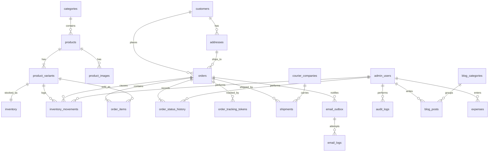

# ZLADOVCE – DATABASE

> Part of the Zladovce master specification. Related documents:
> [PROJECT_SPECIFICATION](PROJECT_SPECIFICATION.md) · [ARCHITECTURE](ARCHITECTURE.md) · [API_SPECIFICATION](API_SPECIFICATION.md) · [AWS_INFRASTRUCTURE](AWS_INFRASTRUCTURE.md) · [IMPLEMENTATION_PLAN](IMPLEMENTATION_PLAN.md)

---

# 14. DATABASE DESIGN

Design a normalized PostgreSQL schema.

Core entities should include:

- AdminUsers
- Products
- ProductVariants
- Categories
- ProductImages
- Inventory
- InventoryMovements
- Orders
- OrderItems
- Customers
- Addresses
- OrderStatusHistory
- OrderTrackingTokens
- Shipments
- CourierCompanies
- StoreSettings
- EmailLogs
- EmailOutbox
- BlogPosts
- BlogCategories
- FaqItems
- Expenses
- AuditLogs

Define:
- Primary keys.
- Foreign keys.
- Unique constraints.
- Indexes.
- Appropriate decimal precision.
- CreatedAt and UpdatedAt.
- Soft deletion where appropriate.

Use UTC timestamps in the database and display local Serbian time in the UI.

Use transactions for checkout, stock operations, and order status changes.

Document the entity relationships.

Do not create unnecessary tables or duplicate information without justification.

---

## Related data rules from the specification

These rules are defined in [PROJECT_SPECIFICATION.md](PROJECT_SPECIFICATION.md) and directly affect the schema:

- Product and order prices must use appropriate decimal types, never floating-point types. (§6)
- Every stock change must be recorded; use transactions and concurrency control to prevent overselling. (§6)
- Order number format `ZLD-YYYY-000001`, unique at database level. (§8)
- Every order status transition is recorded with previous status, new status, timestamp, administrator identity, internal notes and customer-facing message. (§8)
- Order item snapshots (product name, SKU, variant, unit price, quantity, line total) never change when products are edited. (§8)
- Store only a secure hash of the tracking token, never plaintext. (§9)
- Shipping price is stored as a snapshot in each order. (§10)
- Courier companies are configurable database records. (§10)

---
---

# PHASE 1 – DATABASE DESIGN

Everything below this line is Phase 1 output (design), not part of the original master specification.

## D1. Conventions

- PostgreSQL 17 (or the newest version offered by RDS at setup). EF Core with Npgsql, `snake_case` names.
- Primary keys: `uuid` (UUID v7, generated by the application) unless stated.
- Money: `numeric(12,2)`, always RSD. Quantities: `integer`.
- Time: `timestamptz`, stored in UTC. `created_at` on every table, `updated_at` on mutable tables.
- Soft delete (`deleted_at`) only where history must survive: products, variants, categories, blog posts. Unique indexes on slugs and SKUs are partial (`WHERE deleted_at IS NULL`).
- Enums are stored as text with a check constraint, so they are readable in SQL and safe to extend.
- Optimistic concurrency through PostgreSQL `xmin` on `orders`, `products`, `store_settings`.
- Extensions: `citext` (emails), `unaccent` + `pg_trgm` (search that matches "dzem" to "džem").

## D2. Entity relationship diagram

Standalone tables: `store_settings`, `cms_pages`, `faq_items`, `newsletter_subscribers`, `order_number_counters`, `rate_limit_buckets`.

## D3. Tables

### Identity

**admin_users** – local mirror of Cognito administrators, needed for foreign keys and display names.

| Column | Type | Notes |
|---|---|---|
| id | uuid PK | |
| cognito_sub | text | unique |
| email | citext | unique |
| full_name | text | |
| role | text | `Owner`, `Staff` |
| is_active | boolean | inactive users are refused by the API |
| last_login_at | timestamptz null | |
| created_at, updated_at | timestamptz | |

### Catalog

**categories**

| Column | Type | Notes |
|---|---|---|
| id | uuid PK | |
| name | text | |
| slug | text | unique (partial) |
| description | text null | |
| image_key | text null | S3 key |
| sort_order | integer | |
| is_active | boolean | |
| seo_title, seo_description | text null | |
| created_at, updated_at, deleted_at | timestamptz | |

Flat list, no parent category (assumption: the range is small).

**products**

| Column | Type | Notes |
|---|---|---|
| id | uuid PK | |
| category_id | uuid FK → categories | index |
| name | text | |
| slug | text | unique (partial) |
| short_description | text | |
| description | text | sanitised HTML |
| sku | text | base code, unique (partial) |
| is_active | boolean | |
| is_featured | boolean | |
| seo_title, seo_description | text null | |
| created_at, updated_at, deleted_at | timestamptz | `deleted_at` = archived |

Indexes: `(is_active, is_featured)`, trigram index on `unaccent(name)` for search.

**product_variants** – the sellable unit.

| Column | Type | Notes |
|---|---|---|
| id | uuid PK | |
| product_id | uuid FK → products | index |
| name | text | e.g. "370 g" |
| sku | text | unique (partial) |
| unit_amount | numeric(10,3) | e.g. 370 |
| measurement_unit | text | `g`, `kg`, `ml`, `l`, `kom` |
| regular_price | numeric(12,2) | check > 0 |
| discount_price | numeric(12,2) null | check < regular_price |
| is_active | boolean | |
| sort_order | integer | |
| created_at, updated_at, deleted_at | timestamptz | |

**product_images**

| Column | Type | Notes |
|---|---|---|
| id | uuid PK | |
| product_id | uuid FK → products | index |
| storage_key | text | base key of the renditions |
| alt_text | text null | |
| is_main | boolean | partial unique index: one main image per product |
| sort_order | integer | |
| width, height | integer | of the original |
| created_at | timestamptz | |

### Inventory

**inventory** – one row per variant.

| Column | Type | Notes |
|---|---|---|
| variant_id | uuid PK, FK → product_variants | |
| quantity_on_hand | integer | check ≥ 0 |
| low_stock_threshold | integer | check ≥ 0 |
| updated_at | timestamptz | |

**inventory_movements** – append-only; never updated or deleted.

| Column | Type | Notes |
|---|---|---|
| id | uuid PK | |
| variant_id | uuid FK → product_variants | index `(variant_id, created_at desc)` |
| movement_type | text | `InitialStock`, `ManualAdjustment`, `OrderPlaced`, `OrderCancelled`, `ReturnRestock` |
| quantity_delta | integer | check ≠ 0 |
| quantity_after | integer | stock after this movement |
| reason | text null | required for `ManualAdjustment` (check constraint) |
| order_id | uuid FK → orders null | |
| admin_user_id | uuid FK → admin_users null | null = system |
| created_at | timestamptz | |

### Customers

**customers** – guest buyers, one row per email address. No login data.

| Column | Type | Notes |
|---|---|---|
| id | uuid PK | |
| email | citext | unique |
| first_name, last_name | text | latest values |
| phone | text | latest value |
| created_at, updated_at | timestamptz | |

**addresses** – immutable. A changed address is a new row, so an order's address can never change afterwards.

| Column | Type | Notes |
|---|---|---|
| id | uuid PK | |
| customer_id | uuid FK → customers | index |
| city | text | |
| street | text | street and house number |
| postal_code | text | 5 digits |
| created_at | timestamptz | |

### Orders

**orders**

| Column | Type | Notes |
|---|---|---|
| id | uuid PK | |
| order_number | text | unique, `ZLD-YYYY-000001` |
| idempotency_key | uuid | unique |
| customer_id | uuid FK → customers | index |
| shipping_address_id | uuid FK → addresses | |
| status | text | 8 statuses, check constraint |
| contact_first_name, contact_last_name, contact_email, contact_phone | text | snapshot at order time |
| delivery_note | text null | |
| payment_method | text | `CashOnDelivery` (only value in MVP) |
| subtotal | numeric(12,2) | |
| shipping_price | numeric(12,2) | snapshot |
| total | numeric(12,2) | check = subtotal + shipping_price |
| collected_amount | numeric(12,2) null | actual payment received from courier |
| collected_at | timestamptz null | |
| placed_at | timestamptz | |
| created_at, updated_at | timestamptz | |

Indexes: `(status, placed_at desc)`, `(placed_at)`, `(contact_email)`, `(contact_phone)`.

**order_items** – snapshot; never changes after creation.

| Column | Type | Notes |
|---|---|---|
| id | uuid PK | |
| order_id | uuid FK → orders | index |
| variant_id | uuid FK → product_variants | index; for reports and restocking only |
| product_name, variant_name, sku | text | snapshot |
| unit_price | numeric(12,2) | price actually charged |
| quantity | integer | check > 0 |
| line_total | numeric(12,2) | check = unit_price × quantity |

**order_status_history** – append-only.

| Column | Type | Notes |
|---|---|---|
| id | uuid PK | |
| order_id | uuid FK → orders | index `(order_id, created_at)` |
| previous_status | text null | null for the first row |
| new_status | text | |
| changed_by_admin_id | uuid FK → admin_users null | null = created by customer checkout |
| internal_note | text null | never public |
| customer_message | text null | shown on tracking page and in email |
| created_at | timestamptz | |

**order_tracking_tokens**

| Column | Type | Notes |
|---|---|---|
| id | uuid PK | |
| order_id | uuid FK → orders | index |
| token_hash | bytea | SHA-256, unique |
| created_at | timestamptz | |
| revoked_at | timestamptz null | |
| last_used_at | timestamptz null | |

**order_number_counters**

| Column | Type | Notes |
|---|---|---|
| year | integer PK | Serbian local year |
| last_value | integer | locked and incremented inside the order transaction |

### Shipping

**courier_companies**

| Column | Type | Notes |
|---|---|---|
| id | uuid PK | |
| name | text | unique |
| tracking_url_template | text null | e.g. `https://…/{trackingNumber}`, entered by admin only when verified |
| is_active | boolean | |
| sort_order | integer | |
| created_at, updated_at | timestamptz | |

**shipments** – one row per shipping attempt.

| Column | Type | Notes |
|---|---|---|
| id | uuid PK | |
| order_id | uuid FK → orders | index |
| courier_company_id | uuid FK → courier_companies | |
| tracking_number | text null | external courier number |
| shipped_at | timestamptz | |
| note | text null | |
| created_at, updated_at | timestamptz | |

### Notifications

**email_outbox**

| Column | Type | Notes |
|---|---|---|
| id | uuid PK | |
| dedup_key | text | unique; one row per business event |
| template | text | `OrderReceived`, `OrderAccepted`, … , `ContactMessage` |
| order_id | uuid FK → orders null | |
| recipient | citext | |
| payload | jsonb | data for the template, no secrets |
| encrypted_token | bytea null | tracking code, AES-GCM; set to null after sending |
| status | text | `Pending`, `Processing`, `Sent`, `Dead` |
| attempt_count | integer | |
| next_attempt_at | timestamptz | |
| locked_until | timestamptz null | worker lease |
| last_error | text null | |
| created_at, sent_at | timestamptz | |

Partial index on `(next_attempt_at) WHERE status IN ('Pending','Processing')`.

**email_logs** – one row per send attempt.

| Column | Type | Notes |
|---|---|---|
| id | uuid PK | |
| outbox_id | uuid FK → email_outbox | index |
| attempt_number | integer | |
| succeeded | boolean | |
| ses_message_id | text null | |
| error | text null | |
| created_at | timestamptz | |

### Content

**blog_categories**: `id`, `name`, `slug` (unique), `sort_order`, timestamps.

**blog_posts**

| Column | Type | Notes |
|---|---|---|
| id | uuid PK | |
| category_id | uuid FK → blog_categories | |
| author_admin_id | uuid FK → admin_users | |
| title | text | |
| slug | text | unique (partial) |
| excerpt | text | |
| cover_image_key | text null | |
| content_html | text | sanitised on save |
| status | text | `Draft`, `Published` |
| published_at | timestamptz null | public only when Published and `published_at <= now()` |
| seo_title, seo_description | text null | |
| created_at, updated_at, deleted_at | timestamptz | |

**faq_items**: `id`, `question`, `answer`, `sort_order`, `is_published`, timestamps.

**cms_pages** – editable content for homepage sections, O nama, privacy policy, terms.

| Column | Type | Notes |
|---|---|---|
| id | uuid PK | |
| key | text | unique: `home`, `about`, `privacy`, `terms` |
| title | text | |
| content | jsonb | structured blocks per page type (hero text, story, etc.) |
| seo_title, seo_description | text null | |
| updated_at | timestamptz | |

**newsletter_subscribers**: `id`, `email` (citext, unique), `consented_at`, `unsubscribed_at` null, `created_at`.

### Settings, finance, audit

**store_settings** – exactly one row (`id = 1`, check constraint), typed columns.

| Group | Columns |
|---|---|
| Identity | store_name, logo_key, contact_email, phone, business_address |
| Shipping | shipping_enabled, shipping_price, free_shipping_threshold (null = none), min_order_amount (null = none), estimated_delivery_text, delivery_info |
| Social | facebook_url, instagram_url, other_links jsonb |
| SEO | default_seo_title, default_seo_description |
| Meta | updated_at, updated_by_admin_id |

**expenses**: `id`, `expense_date` (date), `category` (text), `description`, `amount` numeric(12,2) check > 0, `created_by_admin_id` FK, timestamps. Index on `expense_date`.

**audit_logs** – append-only.

| Column | Type | Notes |
|---|---|---|
| id | uuid PK | |
| admin_user_id | uuid FK → admin_users null | |
| action | text | e.g. `Product.Updated`, `Order.StatusChanged`, `Auth.Login` |
| entity_type, entity_id | text null | index `(entity_type, entity_id)` |
| changes | jsonb null | changed fields, old and new values, no secrets |
| ip_address | inet null | |
| created_at | timestamptz | index |

**rate_limit_buckets**: `bucket_key` (text, hashed IP + route), `window_start` (timestamptz), `count` (integer); PK `(bucket_key, window_start)`. Old rows are deleted by the outbox worker.

## D4. Tables added beyond the list in §14, and why

| Table | Justification |
|---|---|
| cms_pages | §13 requires editable homepage and About content |
| newsletter_subscribers | §5 requires a newsletter section |
| order_number_counters | Gap-free yearly order numbers (§8) |
| rate_limit_buckets | Per-IP limits that work across Lambda instances (§9, §15) |

## D5. Transactions

| Operation | In one transaction |
|---|---|
| Checkout | idempotency check, stock deduction, order number, customer, address, order, items, history, movements, token hash, outbox row |
| Status change | status update (with concurrency check), history row, shipment row when shipping, stock return when cancelling, outbox row, audit row |
| Stock adjustment | inventory update, movement row, audit row |

## D6. Migrations and seed data

- EF Core migrations, applied by a dedicated migration step in the deployment pipeline, never at application start.
- Changes are backward compatible with the previously deployed code (add first, remove in a later release) so a code rollback never needs a schema rollback.
- Seed: the single `store_settings` row with empty/placeholder values, CMS page keys, and the first Owner record. No invented products, couriers or contact data.
